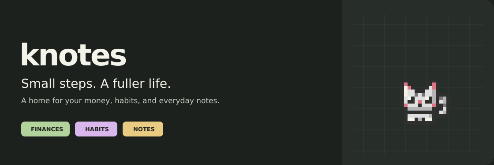
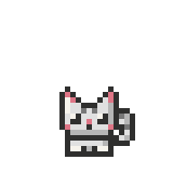

<div align="center">



**A little more clarity. A little more progress. A companion along the way.**

Personal finances, daily habits, and notes in one local-first Flutter app.


[Features](#features) · [How to use](#how-to-use) · [Run locally](#run-locally) · [Technology](#technology) · [Data and backups](#data-and-backups)

</div>

## Meet knotes

Track what comes in, understand what goes out, and make room for everyday routines. knotes brings your accounts, spending plans, notes, and habits together while a pixel companion grows with your progress.

Your everyday data lives on your device. You can use the app without connecting a GitHub account; cloud backup is optional. The current app interface is in Spanish; this guide is in English.

## Features

|                     | What you can do                                                                                              |
| :------------------ | :----------------------------------------------------------------------------------------------------------- |
| **Money**           | Manage multiple accounts, choose which count toward available funds, record income, expenses, and transfers, and organize transactions with categories. |
| **Budgets**         | Plan daily, weekly, or monthly spending, with protected balances and planned commitments.                    |
| **Currencies**      | Choose account currencies and maintain shared manual conversion rates with rate history.                     |
| **Planning**        | Keep recurring payments and dated commitments on a calendar, then review upcoming cash flow.                 |
| **Habits**          | Check in, review current and best streaks, set daily reminders, and chase goals with a deadline (habit check-ins, finished tasks, or a counter you mark). |
| **Notes**           | Keep notes and checklists, capture one from a single line ("- item" becomes a task), search and filter by pending tasks. |
| **Companions**      | Earn XP and grow a cat, rat, raccoon, opossum, rock, or plant through baby, adult, and master stages.        |
| **Personalization** | Choose forest, plum, rose, or honey palettes and light, dark, or system appearance.                          |
| **Android extras**  | Add a native pet home-screen widget and get scheduled reminders with your own messages, even with the app closed. |
| **Backups**         | Export and restore JSON files, keep a week of automatic daily copies, or connect optional GitHub Gist backup. |

<div align="center">
  
  <br />
</div>

## How to use

1. **Make it yours.** Finish onboarding, choose a companion, and pick your appearance and currency preferences.
2. **Add your accounts.** Give each account a name, opening balance, and currency. Set a minimum balance when you want to protect part of it.
3. **Record your day.** Add income, expenses, or transfers. Use categories and notes so your history stays easy to understand.
4. **Plan ahead.** Set a spending budget and add recurring or dated payments. Check the calendar before making new plans.
5. **Build a routine.** Create habits, check them off, and keep notes or lists beside your finances.
6. **Keep a backup.** Open Settings to export your data or connect the optional GitHub backup.

<details>
<summary><strong>Add the Android widget</strong></summary>
Long-press an empty area of your Android home screen, open the widget picker, and select the knotes cat widget.
</details>

## Run locally

The repository includes **Android** and **Linux** targets. Use a Flutter SDK that includes Dart **3.13.5 or later within the 3.x series**, matching `pubspec.yaml`.

```sh
git clone https://github.com/MagusCat/kwallet.git knotes
cd knotes
flutter doctor
flutter pub get
flutter devices
```

Run on an attached Android device or emulator:

```sh
flutter run -d <device-id>
```

Or run the Linux desktop app:

```sh
flutter run -d linux
```

Android development needs the Android SDK and Java 17. Linux needs the Flutter desktop build dependencies (including GTK 3, CMake, Ninja, a C++ toolchain, and SQLite). Optional GitHub credentials on Linux also need `secret-tool` and an unlocked Secret Service keyring.

<details>
<summary><strong>Checks and release builds</strong></summary>

```sh
flutter analyze
flutter test
flutter build apk --release
flutter build linux --release
```

The same commands are available as `make` targets; run `make help` to list them.

The APK is written to `build/app/outputs/flutter-apk/app-release.apk`. Configure your own Android release signing before distribution; the current Gradle configuration uses the debug signing key for release builds.

Increase the build number after `+` in `pubspec.yaml` for each Android update. Universal and per-ABI APKs use that same version code so switching APK formats does not introduce an artificial version jump.

</details>

## Technology

| Layer              | Technology                                       | Role                                                                         |
| :----------------- | :----------------------------------------------- | :--------------------------------------------------------------------------- |
| Interface          | Flutter, Material 3                              | Shared mobile and desktop UI, themes, and responsive layouts.                |
| Application        | Dart, view models, repository contracts          | Feature state and data operations kept separate from presentation.           |
| Persistence        | `sqflite`, `sqflite_common_ffi`                  | Local SQLite storage, migrations, transactions, and desktop database access. |
| Files and backup   | `path_provider`, `path`, `file_picker`, `crypto` | Device files, portable JSON exports, and SHA-256 integrity checks.           |
| Presentation       | `flutter_animate`, `google_fonts`, `intl`        | Motion, typography support, and value formatting.                            |
| Native integration | Android Kotlin and Flutter method channels       | Home-screen widgets, notifications, and credential access.                   |
| Optional cloud     | Dart `HttpClient`, GitHub Gists                  | User-triggered backup and restore with your GitHub account.                  |

Dependency versions are defined in [`pubspec.yaml`](pubspec.yaml) and resolved in [`pubspec.lock`](pubspec.lock).

## Data and backups

The app and Dart package are named `knotes`; Android and Linux use `com.knotes.app`. Android treats this package as a separate app from the former `com.kwallet.raccon`: export a JSON backup from the old installation and import it into knotes to transfer your data. Existing `kwall` JSON backups and `kwall-backup.json` GitHub Gists remain readable. On Linux, existing local databases, recovery copies, and keyring credentials keep their original storage identifiers for continuity; new databases use `knotes/knotes.db`.

Everyday records are stored locally in SQLite. Data exports include the app's managed records, and restores validate the backup before replacing data in a transaction. Recovery copies help with database upgrades and failed restores.

- **JSON exports include a SHA-256 checksum.** It detects changes to the file; the backup itself is not encrypted.
- **Currency rates are manual.** Changing a symbol is not a currency conversion; review your configured rates when using converted values.
- **GitHub backup is optional.** Connect from Settings with a token that can access Gists, then use the sync or restore controls. Secret Gists are unlisted, not encrypted storage.
- **Credentials use the platform key store.** Android uses its native credential bridge; Linux uses Secret Service through `secret-tool`.

## Project layout

```text
assets/pets/       Adult and baby sprite sheets bundled with the app
android/           Android runner, widget resources, and native services
docs/media/        Public README banner and animation
lib/
  app/             App setup and shared dependencies
  core/            Database, contracts, services, themes, and shared widgets
  features/        Finance, journal, welcome, and settings features
linux/             Linux desktop runner
test/              Flutter unit and widget tests
tool/              Artwork import and preview/export tools
```
